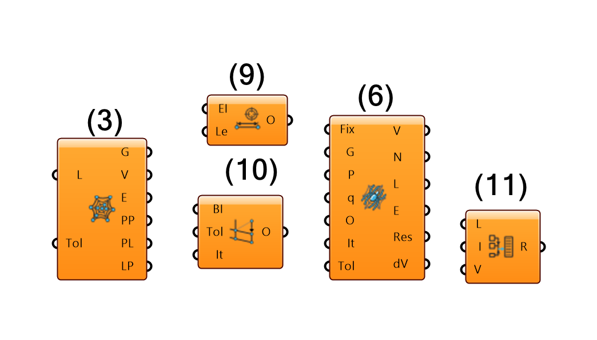
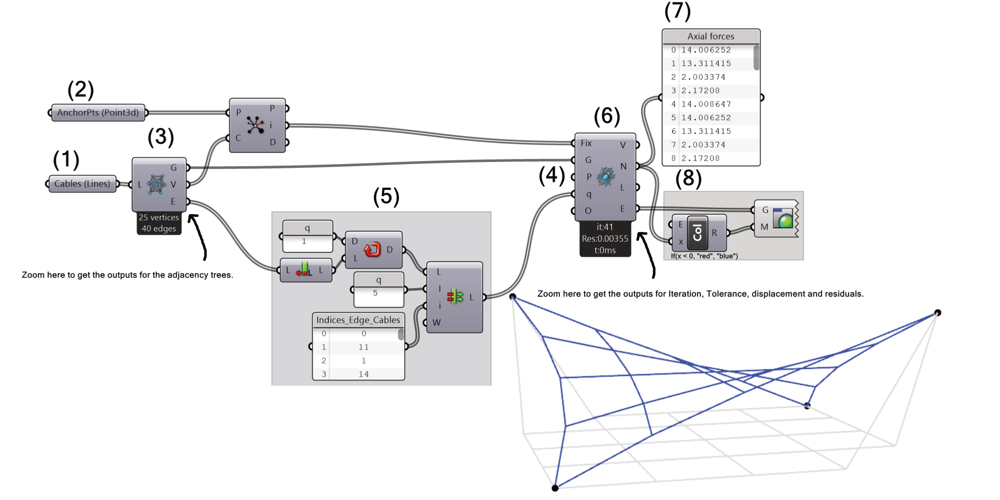
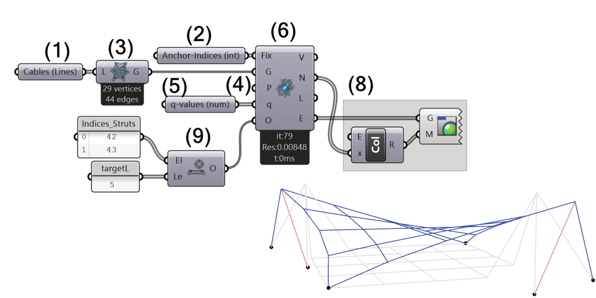
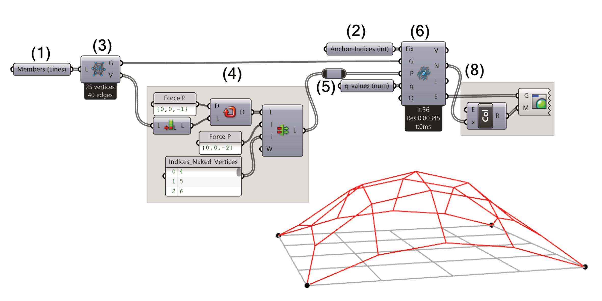
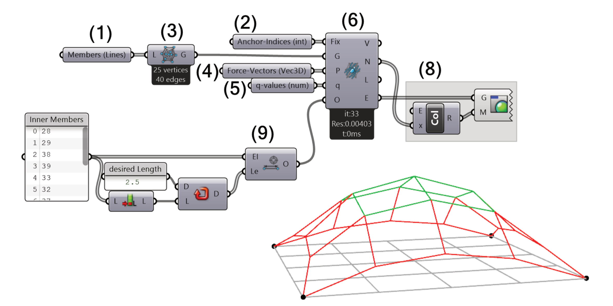
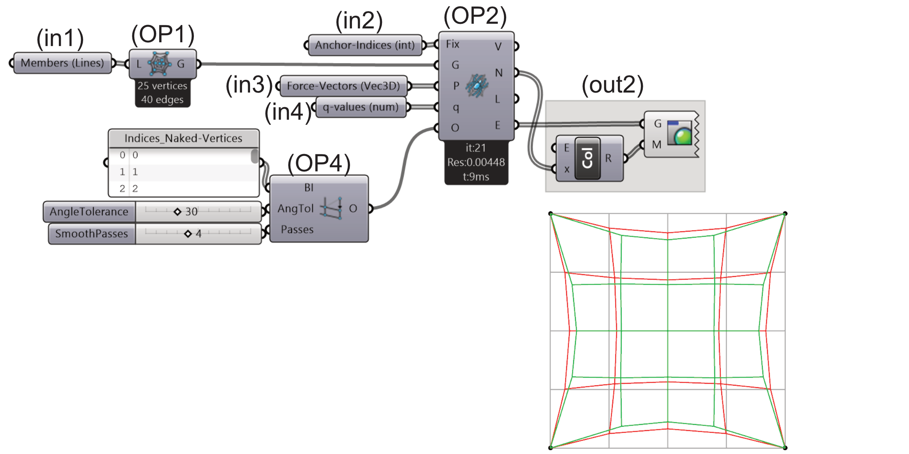
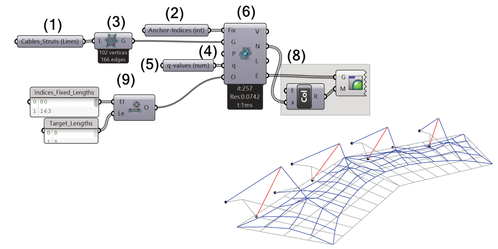
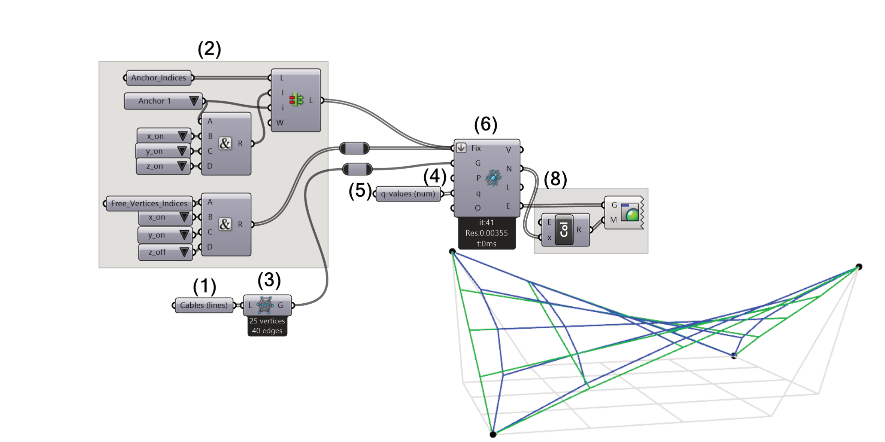
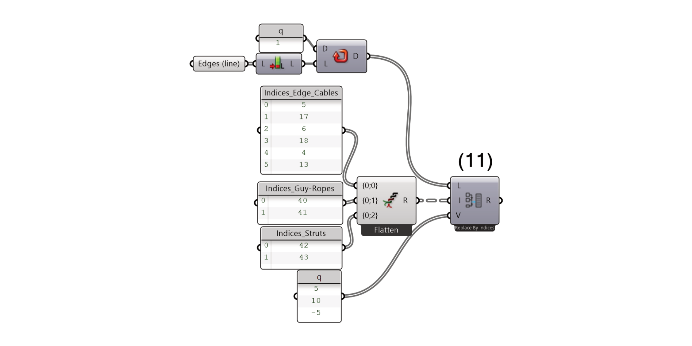

# Opuntia
Force Density Framework for Grasshopper

## Description
Opuntia is a framework for structural form-finding with the Force Density Method (FDM) according to Linkwitz and Schek for the algorithmic modelling software [Grasshopper](https://www.grasshopper3d.com/), which is a plug-in of the commercial 3D computer graphics and computer-aided design application software [Rhinoceros](https://www.rhino3d.com/) (short Rhino3D). The main contribution is an iterative solver based on Jacobi relaxation that computes equilibrium geometries of cable nets and shells directly on a line graph. Constraints such as prescribed edge lengths or the dekinking of boundary nodes are added through a module-based option mechanism, so that further solver methods can be integrated without changing the core solver. The framework was developed in the context of the digital reconstruction of historical cable net structures at the University of Stuttgart. Results were validated against STIFF3D on several examples with deviations below 0.1 %.

The name refers to the opuntia spider (*Cyrtophora citricola*), which is commonly found on prickly pear cacti and builds pretensioned, anticlastic webs. Webs of this kind are documented in the publications of Frei Otto's Institute for Lightweight Structures (IL) in Stuttgart.

*Photo: Olaf Leillinger, Wikimedia Commons, [CC BY 2.5](https://creativecommons.org/licenses/by/2.5/)*

## Documentation

### Components

| No. | Component | Nickname | Category |
|---|---|---|---|
| (3) | Line Graph | LGraph | Opuntia / Graph |
| (6) | Force Density Solver | FDSolver | Opuntia / Solver |
| (9) | Target Length | TargetL | Opuntia / Options |
| (10) | De-Kink | DeKink | Opuntia / Options |
| (11) | Replace By Indices | Replace | Opuntia / Util |

### Typical workflow
All example images use the same numbering:

| No. | Step |
|---|---|
| (1) | Lines: input geometry |
| (2) | Supports: anchor points or vertex indices, optionally with fixed axes |
| (3) | Graph: Line Graph component |
| (4) | Loads: load vector per node |
| (5) | Force densities: q per edge |
| (6) | Solver: Force Density Solver |
| (7) | Results: e.g. axial forces N |
| (8) | Visualisation: edges coloured by the sign of N (blue = tension, red = compression), not part of Opuntia |
| (9) | Target Length option |
| (10) | De-Kink option |
| (11) | Replace By Indices |

Numbers that do not occur in an example are omitted.

### Zoomable inputs and outputs
Optional parameters are hidden by default to keep the components compact. Zoom in on a component until **+** and **−** icons appear next to the parameters, then click **+** to add the next optional parameter or **−** to remove the last one. Optional parameters are always added in the order listed below. If an optional input is not shown, its default value is used.

---

### 1 · Line Graph `LGraph`

Builds a graph from a list of lines. Points within the tolerance are merged to the first point found; duplicate and degenerate edges are removed. The graph `G` is passed to the solver as a single object.

#### Inputs
| Name | Type | Default | Description |
|---|---|---|---|
| L | List&lt;Line&gt; | – | Input lines |

Optional input (zoom in, **+**):

| Name | Type | Default | Description |
|---|---|---|---|
| Tol | double | model tolerance | Point merge tolerance |

#### Outputs
| Name | Type | Description |
|---|---|---|
| G | Opuntia Graph | Graph topology for the solver |

Optional outputs (zoom in, **+**, added in this order):

| Name | Type | Description |
|---|---|---|
| V | List&lt;Point3d&gt; | Vertex positions |
| E | List&lt;Line&gt; | Edges |
| PP | DataTree&lt;int&gt; | Point-to-point adjacency (path = vertex index, values = neighbour vertex indices) |
| PL | DataTree&lt;int&gt; | Point-to-line adjacency (path = vertex index, values = incident edge indices) |
| LP | DataTree&lt;int&gt; | Line-to-point adjacency (path = edge index, values = [start, end] vertex indices) |

---

### 2 · Target Length `TargetL` (Method 1)

Target-length constraint for selected edges (e.g. compression struts). Connect the output to the solver's `O` input.

#### Inputs
| Name | Type | Description |
|---|---|---|
| EI | List&lt;int&gt; | Edge indices subject to the target-length constraint |
| Le | List&lt;double&gt; | Target lengths, paired with EI |

#### Output
| Name | Type | Description |
|---|---|---|
| O | TargetLengthOptions | Option object for the solver |

The force density of a constrained edge is not held constant: in each correction step it is derived from local nodal equilibrium, so that the edge carries exactly the residual force along its axis.

A target length can only be reached if the system has enough free degrees of freedom. If supports, fixed axes and force densities already determine the position of the affected nodes, the system is over-determined and the target length cannot be met. In this case the solver issues a warning (see *Warnings*).

---

### 3 · De-Kink `DeKink` (Method 3)

Boundary dekinking. Removes kinks at selected boundary nodes by extrapolation along collinear neighbours, followed by re-relaxation. Connect the output to the solver's `O` input.

#### Inputs
| Name | Type | Default | Description |
|---|---|---|---|
| BI | List&lt;int&gt; | – | Indices of boundary nodes to dekink |
| Tol | double | 30.0 | Angle tolerance: minimum collinearity angle (degrees) for extrapolation |
| It | int | 3 | Number of dekink + re-relaxation passes after convergence |

#### Output
| Name | Type | Description |
|---|---|---|
| O | DeKinkOptions | Option object for the solver |

---

### 4 · Force Density Solver `FDSolver`

Iterative Force Density solver (Jacobi relaxation) for equilibrium form-finding of cable nets and shells.

#### Inputs
| Name | Type | Default | Description |
|---|---|---|---|
| Fix | List&lt;string&gt; | – | Supports (optional), see below |
| G | Opuntia Graph | – | Graph from LGraph |
| P | List&lt;Vector3d&gt; | – | External load vector per node (optional) |
| q | List&lt;double&gt; | – | Force density per edge |
| O | List&lt;Option&gt; | – | Target Length and/or De-Kink options (optional) |

Optional inputs (zoom in, **+**, added in this order):

| Name | Type | Default | Description |
|---|---|---|---|
| It | int | 1000 | Maximum number of iterations (capped at 10 000) |
| Tol | double | model tolerance | Convergence tolerance |

#### Outputs
| Name | Type | Description |
|---|---|---|
| V | List&lt;Point3d&gt; | Optimised node positions |
| N | List&lt;double&gt; | Axial force per member, N = q · L |
| L | List&lt;double&gt; | Member lengths |
| E | List&lt;Line&gt; | Result edges as lines |

Optional outputs (zoom in, **+**, added in this order):

| Name | Type | Description |
|---|---|---|
| Res | List&lt;double&gt; | Force-equilibrium residual per node (fixed axes excluded) |
| dV | List&lt;double&gt; | Displacement of each node in the final iteration |

The message below the component shows the number of iterations (`it`), the largest nodal residual (`Res`) and the computation time (`t`).

#### Supports
Each entry of `Fix` is a vertex index, optionally followed by the axes to be fixed:

| Entry | Meaning |
|---|---|
| `3` | Vertex 3 fixed in x, y and z |
| `3xy` | Vertex 3 fixed in x and y, free in z |
| `7z` | Vertex 7 fixed in z, free in x and y |

A plain list of integers can be connected directly. Vertex indices can be checked with *Point List* or found with *Closest Point*.

#### Sign convention
| Value | Meaning |
|---|---|
| q > 0 | Tension (cable) |
| q < 0 | Compression (strut/mast) |

#### Method
Each node $i$ is in equilibrium when the edge forces to its neighbours and the external load cancel out:

$$\sum_{j \in N(i)} q_{ij}\,(x_j - x_i) + p_i = 0$$

Solving for $x_i$ gives the Jacobi update used in each iteration $k$:

$$x_i^{(k+1)} = \frac{\sum_{j \in N(i)} q_{ij}\,x_j^{(k)} + p_i}{\sum_{j \in N(i)} q_{ij}}$$

where $x_i$ is the position of node $i$, $N(i)$ the set of its neighbour nodes, $q_{ij}$ the force density of the edge between $i$ and $j$, and $p_i$ the external load at node $i$. In words: each free node moves to the force-density-weighted average of its neighbours, shifted by its load. Fixed axes keep their initial coordinates. Target Length options act during iteration; De-Kink options act after convergence.

#### Convergence
The solver stops when the largest node displacement between two iterations falls below the tolerance, or when It is reached:

$$\max_i \left| x_i^{(k)} - x_i^{(k-1)} \right| < \text{Tol}$$

#### Warnings
| Warning | Cause |
|---|---|
| Not converged | The tolerance was not reached within It iterations. Increase It or check the input. |
| No equilibrium | The displacements have converged, but the largest residual exceeds 0.1 % of the largest member force. Supports, fixed axes or constraints over-determine the system. |
| No supports provided | No `Fix` input. Only self-stressed systems can be solved without supports. |

---

### 5 · Replace By Indices `Replace`

Replaces items of a list at given indices, e.g. to assign individual force densities to selected edges (see Example 8).

#### Inputs
| Name | Type | Description |
|---|---|---|
| L | List | Input list |
| I | List&lt;int&gt; | Indices of the items to replace |
| V | List | Replacement values, paired with I |

#### Output
| Name | Type | Description |
|---|---|---|
| R | List | Resulting list |

---

## Examples
Example definitions are provided in the `examples/` folder. Force densities and index lists are derived step by step in the first example in which they occur. Later examples use them as internalised data. These values refer to the edge order of the Line Graph component and must be updated if the input geometry changes.

### Example 1 · Four-point net

Form-finding of a classic four-point cable net. Two anchor points are raised and two are lowered, resulting in an anticlastic, saddle-shaped surface. All edges are given q = 1, the edge cables are then overwritten with q = 5 (5). P can be left empty for prestressed form-finding (4). Coordinates, force densities and load vectors are taken from the [STIFF example dataset of TU Munich](https://www.cee.ed.tum.de/fileadmin/w00cbe/st/Software/Education/Stiff/Beispiele/Kraftdichte_4P-Zelt_1_3D.xlsx).

### Example 2 · Net with masts and target length

Cable net supported by two masts with guy ropes. The masts are compression struts (red) whose length is prescribed with Target Length (9).

### Example 3 · Shell under load

Compression shell (red) under vertical loads (4). Boundary nodes receive a larger load than inner nodes.

### Example 4 · Shell with target length

As Example 3, with a prescribed length for the inner members (9). Green: constrained edges.

### Example 5 · De-Kink

Top view of a net with De-Kink applied to the boundary nodes (10). Green: result without De-Kink.

### Example 6 · Multi-mast net

Larger cable net with three masts and guy ropes. The mast lengths are prescribed with Target Length (9).

### Example 7 · Per-axis supports

Supports can be fixed per axis (2). The value lists switch individual axes of the anchors and free vertices on or off. Green: result with all axes of the free vertices released.

Note: If all axes of the free vertices are fixed, no vertex can move and no equilibrium shape can be found.

### Example 8 · Assigning force densities

Different force densities are assigned to groups of edges with Replace By Indices (11). All edges start with q = 1. The edges listed in each index group (edge cables, guy ropes, struts) are overwritten with the corresponding value.

## Requirements
- Rhino 8
- .NET Framework 4.8

## Installation
1. Download the `.gha` from the latest [release](../../releases) or build it in Visual Studio (Release).
2. Right-click the file → Properties → **Unblock**.
3. Copy the `.gha` to `%APPDATA%\Grasshopper\Libraries\`.
4. Restart Rhino.

## License
MIT License © 2026 Baris Wenzel. See `LICENSE` for details.
